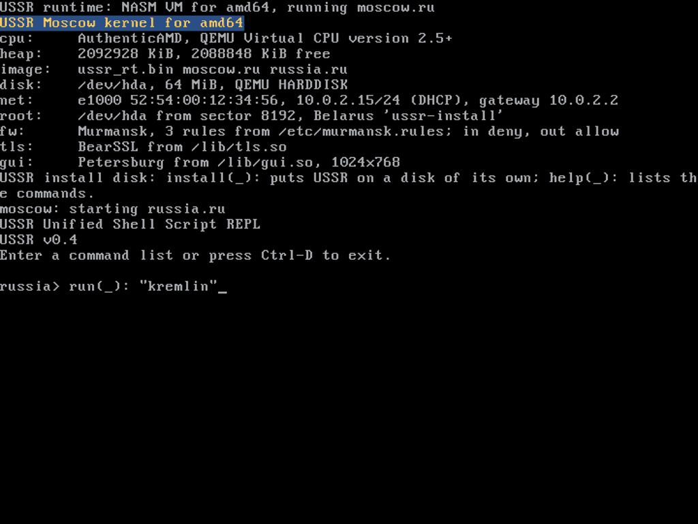

# Mbltishi

The terminal of USSR's desktop: a window that runs the USSR shell, or
any program, with the console in it, as xterm, PuTTY or the Windows
console run theirs. Its name is Mytishchi, the town next to Moscow,
spelt with Mbl's small "bl" for the Ы.

    russia> run(_): "Mbltishi"                    # the shell, russia.ru
    russia> run(_): "Mbltishi" "Mbl" "notes.txt"  # another program

Kremlin, the desktop, starts it from its TERMINAL pin on Moscow
(`Apps/Terminal.kl`).

The window is a Petersburg canvas; the terminal on it is Moscow's own
(`terminal_open`, `terminal_run`, `terminal_close`: `src/moscow/gui.su`
and `src/moscow/lib/gui/term.c`): a grid of characters in Pobeda, the
project's monospace font (`fonts/pobeda.ttf`), Cyrillic and box drawing
included, that carries out the ANSI sequences Moscow's console knows -
cursor moves, erasing, colours - so the shell and the Mbl editor run in
it. Keys typed into the window are the program's input: in the shell's
raw mode the arrows, Home, End, Delete and Page Up/Down come as the
sequences a terminal sends. When the program ends the window closes;
closing the window ends the program (it reads the end of its input, as
Ctrl-D).

On Windows and Linux Mbltishi says so and leaves the terminal to the
system's own.
