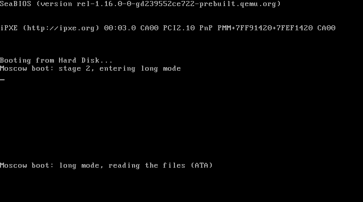

# Moscow



Moscow is the USSR kernel for amd64 PCs. A NASM boot loader starts a
NASM USSR runtime on bare metal, the runtime runs the kernel `moscow.ru`
(compiled from `moscow.su`), and the kernel mounts its root file system,
[Belarus](../belarus/README.md), and runs the shell `russia.ru`:
`src/russia/russia.su`, the USSR interpreter written in USSR, whose REPL
is the shell. The install disk holds it all:

| Part | Source | On the disk |
|------|--------|-------------|
| 1. boot loader | `arch/amd64/boot.nasm` | sectors 0..15 |
| 2. USSR runtime | `arch/amd64/ussr_rt.nasm` | `ussr_rt.bin`, in the boot image |
| 3. kernel | `moscow.su` | `moscow.ru`, in the boot image |
| 3. shell | `../russia/russia.su` | `russia.ru`, in the boot image |
| 4. root file system | `../belarus/belarus.su` | partition 1, from 4 MiB: `/bin`, `/boot`, `/etc`, `/src/ussr` |
| 5. installer | `install.su` | `/bin/install.ru` |

The boot image (parts 1 to 3, `moscow.img` on its own) sits in front of
the partition, where the boot loader reads it; the Belarus partition
holds the programs (`install.ru`, `stalin.ru`, `belarus.ru`), copies of
the boot files, `/etc` and the whole USSR project.

## Build and run

Needs NASM, QEMU and a built `ussr` (it compiles the `.su` files and
makes the disk with Stalin and Belarus):

    sh src/moscow/build.sh                  # -> build/moscow/ussr.img (and moscow.img)
    sh src/moscow/run.sh                    # window + serial on the terminal
    python src/moscow/tools/qemu_test.py    # headless test over serial, install included

`ussr.img` is a raw disk image; `dd` it to a USB stick to boot a real
PC with a BIOS (or CSM) whose disk answers on the legacy ATA ports (IDE,
or SATA in IDE mode); USB and AHCI drivers are not there yet. The
installer, though, writes only to virtual disks.

## Installing

Boot the install disk with a second, empty virtual disk and type
`install(_):` at the prompt:

    qemu-img create -f qcow2 hdd.qcow2 128M
    sh src/moscow/run.sh --hdb hdd.qcow2

```
russia> install(_):

=== USSR installer ===

Installing from /dev/hda (Belarus 'ussr-install')
Disks:
  /dev/hda  64 MiB  QEMU HARDDISK  (the install disk)
  /dev/hdb  128 MiB  QEMU HARDDISK
Install onto [/dev/hdb]:
...
Partitioning:
  1) the whole disk: a new MBR table, one Belarus partition, bootable (erases the disk)
  2) the whole disk: a new GPT table, one Belarus partition (erases the disk; Moscow boots from MBR disks only)
  3) keep the partitions there and add a Belarus one in the free space
  q) quit, changing nothing
Choose [1]:
Size of the Belarus partition in MiB, or max [max]:
File system label [ussr]:
Host name [moscow]: kremlin
What to copy [1]:
Type yes to go ahead [no]: yes
...
Belarus file system 'ussr' made in partition 1; copying:
  /
  /bin/
  /boot/
  /etc/
  /src/
808 files and directories copied; checking:
127 directories, 686 files, 7808255 bytes; 813 inodes, 8 block map nodes, map depth up to 2

Done: /dev/hdb boots USSR Moscow now. Halt, take the install disk out and boot from it.
```

The installer, `install.su`, is a USSR script: Stalin (`stalin_main`)
makes the partition table, Belarus the file system; the files go across
extent by extent with `bcopy`, then the boot image and the MBR's boot
code. It writes to QEMU disks only (their model says so) and never to
the install disk. Under `ussr` it installs into a disk image file the
same way, and refuses raw disks:

    ussr src/moscow/install.su --source build/moscow/ussr.img --target disk.img

## A session

    USSR Unified Shell Script REPL
    USSR v0.4
    Enter a command list or press Ctrl-D to exit.

    russia> foo(r): x [ set(r): {x * x} ]
    russia> foo(z): 7
    russia> print(_): z
    49
    russia> struct(P): "x:number" "y:string"
    russia> new(p): "P" 3 "q"
    russia> print(_): p
    P{x=3,y=`q`}
    russia> uptime(_):
    up 12 s
    russia> ls(_):
    d          0  bin
    d          0  boot
    d          0  etc
    d          0  src
    russia> run(st): "stalin" "show" "/dev/hda"
    Disk /dev/hda: 64 MiB, 131072 sectors of 512 bytes
    Table: MBR, disk signature 0x3CB66ED4
    #   START     END  SECTORS    SIZE  TYPE     FS       LABEL
    1*   8192  131071   122880  60 MiB  belarus  belarus  ussr-install
    Free: 1..8191 (4 MiB)
    russia> help(_):

Everything typed is USSR, run by russia.su's tree walker. The commands
russia.su does not know itself go to its host the way they go to ussr
when it runs on Windows or Linux (`ex_ext_b`: an `eval` of a one-line
call); on Moscow the host is the runtime, so they are kernel commands.
The file commands are the kernel's (`moscow.su` takes them over with
`k_syscall`) and work on the root file system:

| Command | Prints and returns |
|---------|--------------------|
| `ls(v): [path]`, `tree(_): [path]` | a directory, everything under a path |
| `cat(s): path`, `readfile(s): path` | a file's text |
| `writefile(r): path text` | writes a file (and its directories) |
| `make_dir`, `remove_file`, `file_exists`, `is_dir`, `list_dir` | as in ussr |
| `run(status): name [args ...]` | `/bin/name.ru` with the arguments (else a program of the boot image); 127 when missing |
| `install(status):` | the installer, `/bin/install.ru` |
| `df(_):`, `fsck(n):` | the root file system and its free space; a check |
| `uptime(s):` | seconds since boot |
| `mem(v):` | `[heap bytes, free bytes]` |
| `cpu(s):` | CPUID vendor and brand |
| `uname(s):`, `pwd(s):` | `USSR Moscow amd64`, `/` |
| `clear(_):`, `color(_): fg bg` | the screen, VGA colours 0..15 |
| `sleep(_): ms` | waits |
| `getenv`, `setenv`, `unsetenv` | the environment (`PS1` is the prompt, `HOSTNAME` comes from `/etc/hostname`) |
| `reboot(_):`, `halt(_):` | reset; stop |
| `help(_):` | this list |

Ctrl-D on an empty line ends the shell, and Moscow halts the machine
(QEMU exits when started with `isa-debug-exit`).

## Boot

- **Stage 1** (the MBR, 512 bytes) reads stage 2 with the BIOS extended
  disk read and jumps to it.
- **Stage 2** uses the BIOS only for what only it knows: A20 and the
  e820 memory map. It builds identity page tables for the first 4 GiB
  (2 MiB pages) and goes from real mode straight to long mode. From
  there on everything is 64-bit: an ATA PIO driver (primary master,
  LBA28) reads the file table (`MOSCOWFS`, sector 16) and every file it
  lists to memory from 1 MiB up, with no 640 KiB window, and stage 2
  jumps to the runtime (always the first file) with the boot information
  block in `rdi`.
- `arch/amd64/layout.inc` holds the sector and memory layout;
  `arch/amd64/image.nasm` assembles the disk with `incbin`.

Progress messages go to the screen and COM1, so a headless boot shows
where it stopped.

## The kernel

At boot `moscow.su` lists the disks (`bdevices`), mounts the first
Belarus file system it finds as the root, sets `HOSTNAME` from
`/etc/hostname`, prints `/etc/motd` and registers its commands. A kernel
command is a USSR function of `moscow.ru` taking its arguments as one
vector; the runtime calls it whenever a program loaded later (the shell,
a program of `/bin`) or an `eval` uses that name. It runs in the calling
program's memory and keeps nothing between calls but the root's device
and first sector: it mounts the file system each time, and writes
changes back before it returns. `run` reads the program from the file
system and hands it to `k_exec_bytes`. Without a Belarus disk (booting
`moscow.img` alone) the kernel still runs the shell, with no root.

## The runtime

`ussr_rt.nasm` is the USSR VM in assembly. It loads its own GDT and IDT
(CPU exceptions print and stop), sets up the console (VGA text mode and
COM1 at 115200, the PS/2 keyboard), the PIT at 100 Hz and the heap, then
loads `moscow.ru` and runs it.

Memory: the heap is the largest usable RAM region of the BIOS map above
the loaded files. When RAM goes past the boot loader's 4 GiB identity
map, the runtime maps the rest (2 MiB pages, up to 64 GiB) with tables
taken from the heap. russia.ru needs a few hundred MiB for a long
session; the scripts give QEMU 2 GiB.

It reads `.ru` files as `ussr -c` writes them (format 3, VM ABI 3,
checked with the CRC) and runs them as `docs/USSR_VM_SPEC.md` describes:
32 registers, frames with their own locals, `init(ret): arg_cnt arg_vec`
as the entry point, `name!`/`name?` hash entries. Names are interned at
load time, so variables and builtins are found by index; the call-site
table gives builtins their return name (`struct(Name):`). Values are
null, 64-bit integers, reals (SSE2, printed like `%g`), strings,
booleans, vectors, structs and btrees (`btree.inc`, the same B+ tree
map as ussr's `src/btree.c`; it deletes lazily, the bump heap giving no
memory back anyway). `EVAL` runs what russia.su hands its host (lines
of builtin calls with variable, string, number or literal arguments);
`TEMPLATE` prints; `DECODE_UNO` loads `'...'` literals; `try` runs a
function in a VM of its own and reports whether it failed. Not
supported: `EXTERNAL`, `SCAN`, `GET`, `CHAIN`, `FILE`, `CD` (a program
using one stops with a message). `time` reads the RTC.

Disks (`ata.inc`): an ATA PIO driver (LBA28, polled, the cache flushed
after writes) finds the four IDE positions at boot and serves ussr's
block commands on them: `bread`, `bwrite`, `bsize`, `bcopy` and
`bdevices`, with the disks named `/dev/hda` .. `/dev/hdd`. Offsets are
bytes underneath (lba times any sector size), so Belarus and Stalin run
unchanged; a write that covers a disk sector in part reads it first.
`sha256.inc` gives Stalin the hash it makes GUIDs and disk signatures
with.

Builtins with the hosted ussr's meaning: `len byte slice chr vec push
pop at typeof struct new getf setf encode decode try write_stderr fail
text_bytes bytes_text crc32 sha256 clear_bytes btree btput btget bthas
btdel btlen btfirst btlast btfloor btceil btprev btnext btrange btkeys
bread bwrite bsize bcopy bdevices getenv setenv unsetenv getcwd terminal_getch
terminal_raw terminal_sane terminal_key_ready terminal_size sleep
file_exists readfile` (`gc`, `alias`, `keybind` answer null). Library
code such as `src/libs/strings.su` is compiled into the `.ru`.
`terminal_getch` hands out a line at a time: the line is read with echo
and Backspace, as a cooked terminal does, so russia.su reads it as from
a pipe.

The kernel's own services, used by `moscow.su`:

| Command | Does |
|---------|------|
| `k_getline(line):` | a console line (keyboard or serial), echoed, Backspace erases |
| `k_prompt(_): text` | text without a line end |
| `k_clear(_):` | clears the screen |
| `k_color(_): fg bg` | VGA colours 0..15 |
| `k_ticks(n):` | timer ticks since boot, 100 a second |
| `k_mem(v):` | `[total free]` heap bytes |
| `k_cpu(s):` | CPUID vendor and brand |
| `k_modules(v):` | file names in the boot image |
| `k_exec(status): name [args ...]` | runs a `.ru` of the image to its end; 127 when missing |
| `k_exec_bytes(status): bytes [args ...]` | runs the `.ru` in a byte vector (args: strings, or one vector of them) |
| `k_syscall(_): name function` | the kernel's `function` answers `name` from now on |
| `k_reboot(_):`, `k_halt(_):` | reset; stop |

The heap is a bump heap with marks: `k_exec` (and `run`) release
everything the program allocated, and the struct types it declared,
when it ends. There is no collector inside one program yet.

## Tools

- `tools/rudump.py program.ru` lists a `.ru` file's instructions;
  `--summary` lists the opcodes and commands it uses, which is what the
  runtime has to provide.
- `tools/qemu_test.py` boots the install disk with COM1 on a TCP
  socket, types USSR into the russia.su REPL and checks each answer (as
  the hosted ussr gives them, plus the kernel's file commands, Stalin
  from `/bin` and the btree container), changes the prompt with
  `setenv`, and checks that Ctrl-D halts QEMU. Then it boots again with
  an empty qcow2 disk, runs `install(_):` and answers its questions, and
  boots the installed disk alone to check it (`--no-install` skips
  that).
