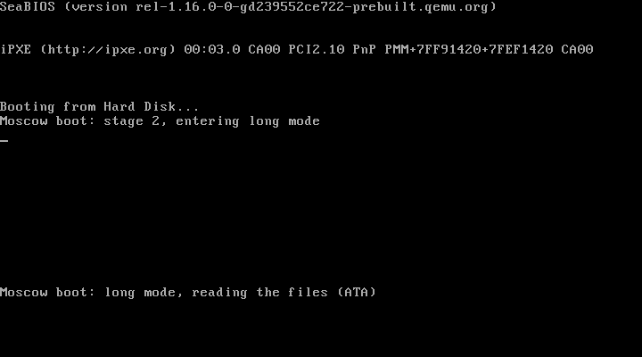
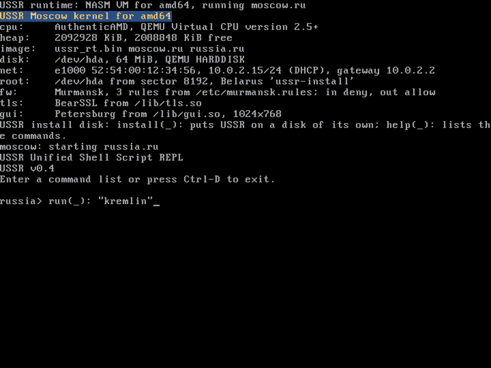

# Moscow



Moscow is the USSR kernel for amd64 PCs. A NASM boot loader starts a
NASM USSR runtime on bare metal, the runtime runs the kernel `moscow.ru`
(compiled from `moscow.su`), and the kernel mounts its root file system,
[Belarus](../belarus/README.md), and starts the Rush shell from `rush.ru`.
The install disk contains:

| Part | Source | On the disk |
|------|--------|-------------|
| 1. boot loader | `arch/amd64/boot.nasm` | sectors 0..15 |
| 2. USSR runtime | `arch/amd64/ussr_rt.nasm` | `ussr_rt.bin`, in the boot image |
| 3. kernel | `moscow.su` | `moscow.ru`, in the boot image |
| 4. shell | `../russia/rush.su` | `rush.ru`, in the boot image |
| 5. Russia compatibility runtime and compiler | `../russia/russia.su` | `russia.ru`, in the boot image |
| 6. root file system | `../belarus/belarus.su` | partition 1, from 4 MiB: `/bin`, `/boot`, `/etc`, `/src/ussr` |
| 7. installer | `install.su` | `/bin/install.ru` |

The boot image (`moscow.img`) sits in front of the partition. The Belarus
partition holds the precompiled installer and disk tools, Kremlin, Mbltishi,
Mbl, copies of the boot files, `/etc`, and the USSR source tree.

Rush keeps the `russia>` prompt, line editing, history and USSR
`name(result): arguments` syntax. Single commands with literal or variable
arguments run directly on the NASM VM. Expressions, control flow and command
lists use `/bin/ussr -c` to compile the submission before the NASM VM executes
it. Declare interactive functions in their own submission to reuse them later.

A single command can launch a program by name at the prompt:

    Mbl():
    kremlin():
    head(_): "/etc/motd" 3

Rush gives native commands precedence, then uses Moscow's executable lookup.
Use an explicit path such as `/bin/ls.ru():` to select a program that shares
a native command's name. Use `head(status):` to capture the exit status.
Empty parentheses and `_` discard the status. For executable calls inside
compiled command lists or with expression arguments, use `run(status): "name" ...`.

Use `run(status): "ussr" "-c" "/home/example.su" "/home/example.ru"` to
generate NASM-compatible bytecode. `run(status): "russia" "-c"
"/home/example.su" "/home/example.ru"` builds a Russia compatibility file.
Moscow chooses the runtime for a `.ru` from its header.

Moscow is 64-bit monolithic OS kernel on it's own (not POSIX not UNIX-like not Microsoft and not *BSD)
However it inevitably has some traits usually found in the Unix world(zoo)

The [China package](../china/README.md) supplies precompiled command-line
programs on the live ISO and installed system. Use `run(_): "china"`
in Rush to list them.

## Console accounts

The stock live media start a single master-admin session named `ted`.
The Moscow installer asks for a username and password for the first
master admin. The username defaults to `ted` and the role is `ted`.
Installed systems ask for the account and password at boot. Older
installations without an account database offer initial setup at the
physical or serial console.

`reguser(): "alice"` creates an ordinary account. A logged-in master
admin can also assign the `ted` role with `reguser(): "alice" "ted"`.
Passwords are 12–128 printable ASCII characters and are entered without echo. `/etc/passwd` records the username,
role, salt, and PBKDF2-HMAC-SHA256 verifier. There is no `sudo`. Reboot
to log in as a different user. `whoami():` reads the console identity from
the kernel.

Ordinary accounts can run packaged USSR bytecode and write to shared
`/home` and `/tmp`. All roles other than `ted` have the same permissions.
Raw devices, native executable loading, and account creation require the
master-admin session. This is a single console account model with shared
read access to the root filesystem.

Run the QEMU account checks with `python src/moscow/tools/accounts_test.py`.

## Build and run

Needs GNU make, NASM, QEMU and a built `ussr` (it compiles the `.su` files
and makes the disk with Stalin and Belarus); on Windows, make runs in WSL:

    make -f ussr-ubuntu.mk ussr             # the host's ussr
    make -f moscow.mk -j8                   # -> build/moscow/ussr.img, moscow.img, ussr.iso
    sh src/moscow/run.sh                    # window + serial on the terminal
    python src/moscow/tools/qemu_test.py    # headless test over serial, install included

`moscow.mk` (at the root) builds only what changed since the last run, but
the disk and the ISO, which take the project's files every time. Each piece
says what it needs: clang and ld.lld for the C libraries in `/lib`; Linux
with gcc, flex, bison, perl and curl for the Linux programs in `/bin`;
xorriso for the ISO. Without one the disk is made without that piece (what
an earlier build left goes on it) and a line says so; `STRICT=1`, as a
release builds, makes that an error. `make -f moscow.mk boot` makes the boot
image alone, `img` the disk, `iso` the ISO, `clean` all but what was fetched
and built from it.

On Ubuntu, the full disk build needs these packages:

    sudo apt update
    sudo apt install build-essential clang lld nasm flex bison perl curl xorriso \
        cmake pkg-config libsqlite3-dev libcurl4-openssl-dev libssl-dev zlib1g-dev
    make -f ussr-ubuntu.mk ussr
    make -f moscow.mk -j"$(nproc)" STRICT=1

Moscow's Petersburg GUI uses its own GLFW-compatible window layer and
software OpenGL renderer on a firmware framebuffer (UEFI GOP or BIOS VBE),
with Bochs DISPI as a fallback; it does not need Ubuntu's GLFW or Mesa
development packages. For Kremlin on physical hardware, boot the
UEFI-enabled ISO to use GOP; BIOS mode depends on the video adapter's VBE
support. The UEFI live root is volatile. To build the hosted Linux `ussr` with
GLFW and OpenGL instead, install `libglfw3-dev libgl1-mesa-dev` and build
with `make -f ussr-ubuntu.mk -j"$(nproc)" PETERSBURG_BUNDLE=1 ussr`.

`ussr.img` is a raw disk image; write it to a USB stick to boot a real
PC with a BIOS (or CSM). The BIOS loads the boot files and, when its EDD
drive parameters identify the boot device as USB, Moscow copies the
Belarus partition into RAM for `/dev/ram`. This root is writable for that
boot, but its changes are lost at power-off; it needs enough contiguous
RAM below 4 GiB. On other BIOS boot devices the root stays on the IDE or
AHCI SATA disk. Native USB and NVMe storage drivers are not there yet.
The installer writes only to virtual disks: QEMU's and VirtualBox's.

In VirtualBox: the ISO on an IDE (PIIX4) CD drive, a disk on the SATA
(AHCI) controller, `install(_):` onto `/dev/sda`, then the ISO out and
the machine boots from the disk. The display may be VMSVGA, VBoxSVGA or
VBoxVGA.

In Bochs 3.1: double-click `src/moscow/bochsrc.bxrc`, or from
`src/moscow`:

    bochs -q -f bochsrc.bxrc

Its paths are relative to `src/moscow`, the folder a double-click starts
Bochs in. The install disk is the primary master and boots first; the
ISO is in the secondary master's tray (`/dev/hdc`), booted with
`boot: cdrom`. COM1 goes to `build/moscow/bochs-com1.txt`, and Bochs's
VGA (the Bochs VBE Kremlin draws on, on PCI) and ACPI are there, so the
desktop runs and Ctrl-D powers Bochs off. Bochs is a slower machine than
QEMU: the boot takes some seconds more.

## The ISO

`build/moscow/ussr.iso` holds the same files as the install disk's Belarus root,
in ISO 9660 with Joliet and Rock Ridge, so Windows, Linux and the rest read them
under their long names. A release ships it as `USSR050.ISO` for the tag 0.5.0, next to
`USSR050.img`. `moscow.mk` makes it when `xorriso` is there, and
`tools/iso_test.py` reads its Joliet tree back with no ISO library and compares
every file.

It boots, on a BIOS PC or in QEMU, from a CD drive on the IDE channels. The whole
`ussr.img` is inside as `/boot/ussr.img`, the El Torito boot file: the BIOS loads
its loader, the loader reads the rest over ATAPI, and the kernel sees that image as
a disk, `/dev/hdc` or wherever the drive is, with its Belarus root. A CD takes no
writes, so they go to memory: everything works, and what you wrote is gone at the
next boot. `install(_):` from it puts USSR on a disk, QEMU's virtual ones only, as
from the install disk.

```bash
qemu-system-x86_64 -m 2048 -cdrom USSR050.ISO
```

It boots from UEFI too: a second El Torito entry, `/boot/efiboot.img`, is an EFI
system partition (FAT12, made by `tools/mkesp.su`) with `\EFI\BOOT\BOOTX64.EFI`, the
UEFI loader (`efi/loader.c`). The loader finds the image through the firmware, so the
CD drive may be on any controller. When Rufus writes the ISO in its recommended
ISO Image mode, the UEFI loader also searches EFI-readable filesystems for
`\boot\ussr.img`, loads its boot files and copies the whole image into memory:
the kernel's root is that RAM disk, `/dev/ram`, writes and all, gone at
the next boot as from the CD. UEFI has no VGA text mode, so the console draws on the
firmware's framebuffer (GOP), 80x25 cells in an 8x16 font made from Pobeda
(`arch/amd64/fbfont.inc`, by `tools/fbfont.py`), scaled to the screen; Kremlin runs
as from a BIOS boot and gives the screen back to the console when it ends.

After UEFI hands off, Moscow polls PCI xHCI for a USB HID boot keyboard and
relative mouse. Plug them directly into USB 2.0 or USB 3.x ports before boot.
The keyboard serves the text console and Petersburg windows, including
Kremlin. The mouse serves the graphical desktop. Moscow reads the HID report layout for vertical scrolling
and falls back to the boot mouse format. A middle click opens a desktop item
in Kremlin, like a double click. PS/2 keyboards also work in the desktop.
PS/2 and COM1 also work at the text console.

```bash
qemu-system-x86_64 -m 2048 -bios edk2-x86_64-code.fd -cdrom USSR050.ISO   # or pflash, as OVMF likes
```

In VirtualBox, enable **System > Motherboard > Enable EFI** to boot the ISO using
GOP, as on UEFI hardware. With EFI off, the BIOS loader uses VBE mode
1024x768x32 when the adapter provides it; Kremlin otherwise requires a Bochs VBE
adapter. For a BIOS boot, the CD drive must be on IDE (a CD on SATA boots, but
stage 2 does not find it). A disk Moscow is installed on boots from the BIOS (or
CSM) only, as yet: the installer does not make an EFI system partition.

## Installing

Boot the install disk with a second, empty virtual disk and type
`install(_):` at the prompt:

    qemu-img create -f qcow2 hdd.qcow2 128M
    sh src/moscow/run.sh --hdb hdd.qcow2

```
russia> install(_):

=== USSR installer ===

Installing from /dev/hda (Belarus 'ussr-install')
Disks:
  /dev/hda  64 MiB  QEMU HARDDISK  (the install disk)
  /dev/hdb  128 MiB  QEMU HARDDISK
Install onto [/dev/hdb]:
...
Partitioning:
  1) the whole disk: a new MBR table, one Belarus partition, bootable (erases the disk)
  2) the whole disk: a new GPT table, one Belarus partition (erases the disk; Moscow boots from MBR disks only)
  3) keep the partitions there and add a Belarus one in the free space
  q) quit, changing nothing
Choose [1]:
Size of the Belarus partition in MiB, or max [max]:
File system label [ussr]:
Host name [moscow]: kremlin
What to copy [1]:
Type yes to go ahead [no]: yes
...
Belarus file system 'ussr' made in partition 1; copying:
  /
  /bin/
  /boot/
  /etc/
  /src/
808 files and directories copied; checking:
127 directories, 686 files, 7808255 bytes; 813 inodes, 8 block map nodes, map depth up to 2

Done: /dev/hdb boots USSR Moscow now. Halt, take the install disk out and boot from it.
```

The installer, `install.su`, is a USSR script: Stalin (`stalin_main`)
makes the partition table, Belarus the file system; the files go across
extent by extent with `bcopy`, then the boot image and the MBR's boot
code. It writes to QEMU disks only (their model says so) and never to
the install disk. Under `ussr` it installs into a disk image file the
same way, and refuses raw disks:

    ussr src/moscow/install.su --source build/moscow/ussr.img --target disk.img

## A session

    USSR Unified Shell Script REPL
    USSR v0.5
    Enter a command list or press Ctrl-D to exit.

    russia> foo(r): x [ set(r): {x * x} ]
    russia> foo(z): 7
    russia> print(_): z
    49
    russia> struct(P): "x:number" "y:string"
    russia> new(p): "P" 3 "q"
    russia> print(_): p
    P{x=3,y=`q`}
    russia> uptime(_):
    up 12 s
    russia> ls(_):
    -        112  .ussr_history
    d         57  bin
    d         54  boot
    d         31  etc
    d         14  src
    russia> run(st): "stalin" "show" "/dev/hda"
    Disk /dev/hda: 64 MiB, 131072 sectors of 512 bytes
    Table: MBR, disk signature 0x3CB66ED4
    #   START     END  SECTORS    SIZE  TYPE     FS       LABEL
    1*   8192  131071   122880  60 MiB  belarus  belarus  ussr-install
    Free: 1..8191 (4 MiB)
    russia> help(_):

Everything typed is USSR, run by russia.su's tree walker. The commands
russia.su does not know itself go to its host the way they go to ussr
when it runs on Windows or Linux (`ex_ext_b`: an `eval` of a one-line
call); on Moscow the host is the runtime, so they are kernel commands.
The file commands are the kernel's (`moscow.su` takes them over with
`k_syscall`) and work on the root file system:

| Command | Prints and returns |
|---------|--------------------|
| `ls(v): [path]`, `tree(_): [path]` | a directory, everything under a path |
| `cat(s): path`, `readfile(s): path` | a file's text |
| `writefile(r): path text` | writes a file (and its directories) |
| `make_dir`, `remove_file`, `file_exists`, `is_dir`, `list_dir` | as in ussr |
| `run(status): name [args ...]` | a program with the arguments: `/bin/name.ru`, `/bin/name.su` or the project's `/src/ussr/src/name/name.su`, or a path; a `.su` is compiled by `/bin/ussr -c` and runs on the NASM runtime, or through russia.ru when there is no `/bin/ussr` (see [Three runtimes](#three-runtimes)); else a program of the boot image; 127 when missing |
| `runtime(r): name` | which runtime `run` gives the program: 1 `/bin/ussr`, 2 the NASM runtime, 3 russia.ru, 0 when it is not there; a `.su` is compiled and checked to tell |
| `open_file(h): path [mode]`, `read_line(s): h`, `read_file(s): h [n]`, `write_file(n): h text`, `close_file(r): h` | files by handle, as in ussr: `r`/`rb` read (-1 for no such file), `w` writes anew, `a` appends; what is written reaches the disk at `close_file` |
| `install(status):` | the installer, `/bin/install.ru` |
| `df(_):`, `fsck(n):` | the root file system and its free space; a check |
| `net(v):`, `ping(n): host [count]` | the network card and address; ICMP echo |
| `socket_tcp`, `socket_bind`, `socket_listen`, `socket_accept`, `socket_recv`, `socket_send`, `socket_close`, `socket_connect`, `wait_readable`, `wait_writable` | TCP as in ussr, over the kernel's own stack |
| `rename_path(r): from to`, `localtime(v): [seconds]` | as in ussr (UTC) |
| `bread`, `bwrite`, `bsize` on a path outside `/dev` | inside a file of the root file system, as ussr does on a host file: Dubna KV keeps its pages so |
| `uptime(s):` | seconds since boot |
| `mem(v):` | `[heap bytes, free bytes]` |
| `cpu(s):` | CPUID vendor and brand |
| `uname(s):`, `pwd(s):` | `USSR Moscow amd64`, `/` |
| `clear(_):`, `color(_): fg bg` | the screen, VGA colours 0..15 |
| `sleep(_): ms` | waits |
| `getenv`, `setenv`, `unsetenv` | the environment (`PS1` is the prompt, `HOSTNAME` comes from `/etc/hostname`) |
| `reboot(_):`, `halt(_):` | reset; stop |
| `help(_):` | this list |

Ctrl-D on an empty line ends the shell, and Moscow powers the machine
off: ACPI's S5 (QEMU exits with or without `isa-debug-exit`; a VirtualBox
VM goes to "powered off").

The console is a terminal: the shell reads its lines in raw mode, so
Up and Down go through the history, which it keeps in
`$HOME/.ussr_history` (`HOME` is `/`), and full-screen programs draw
with ANSI escapes on the VGA screen as on a serial terminal.

## Editing a file: Mbl

The Mbl editor (`src/Mbl/Mbl.su`, a vi-like editor) runs from its
source in the text console or in Kremlin's Mbltishi terminal:

    russia> run(_): "Mbl" "/home/notes.txt"

`i` inserts text, Esc returns to normal mode, and `:wq` saves and quits.
The saved file persists across reboots on an installed Belarus disk.
On a live ISO's RAM-backed root, it lasts through the current boot.

    russia> cat(_): "/home/notes.txt"

The name resolves to `/src/ussr/src/Mbl/Mbl.su`, included on the install
disk and in a full installation. Russia runs the editor from source
when Moscow's NASM runtime lacks its optional vector operations.
On the VGA screen a UTF-8
character takes one cell, as Mbl counts them; the VGA font has only
the ASCII ones, the others show as a block (a serial terminal shows
them all).

## The network: Novgorod from Moscow

Moscow has a TCP/IP stack of its own: the runtime drives the network
card (an Intel e1000, QEMU's usual one: `arch/amd64/net.inc`), and
`src/moscow/net.su`, USSR in the kernel, speaks Ethernet, ARP, IPv4,
ICMP, DHCP and TCP over it. At boot DHCP gives the address:

    net:     e1000 52:54:00:12:34:56, 10.0.2.15/24 (DHCP), gateway 10.0.2.2

The DHCP client (`src/moscow/dhcp.su`) keeps the lease: it asks the
server again at T1 (half the lease unless the server says otherwise),
asks any server at T2, and starts again from DISCOVER on a NAK or when
the lease runs out. `dhcp(_):` shows the lease, `dhcp(_): "renew"`
renews it now, and `dhcp(_): "release"` gives the address back:

    russia> dhcp(_):
    10.0.2.15 from 10.0.2.2, lease 86400s, renews in 43187s, ends in 86387s

The socket commands are the hosted ussr's, so the ROUND programs run
unchanged. Novgorod, the forum, from its source, on a port QEMU
forwards from this machine:

    sh src/moscow/run.sh --web 8080
    russia> run(_): "novgorod" "--http" "--host" "0.0.0.0" "--port" "8080" "--data" "/home/novgorod" "--static" "/src/ussr/src/novgorod/static" "--kvdb" "/home/novgorod/posts.kv"

and then http://127.0.0.1:8080/ in a browser on this machine. Its
posts go into a Dubna KV store, `/home/novgorod/posts.kv` (without
`--kvdb`, into files under `/home/novgorod/posts`): they are there
after the next boot.

How it works: nothing runs by itself, the card is polled. Every socket
command first reads what has come and answers it (ARP, ping, TCP),
retransmits what is overdue and then does its own work; a server
waiting for a client is the stack's clock. TCP keeps to what a server on
a quiet network needs: both handshakes, in-order data (a segment out of
order is dropped and acknowledged again), the peer's window, go-back-N
retransmission with a doubling timeout, FIN both ways and RST. What
comes in and what waits to be acknowledged are byte vectors, so any
bytes travel; `socket_recv` gives them as text (a USSR string holds no
byte 0), `socket_recv_bytes` as they are. There is one address;
`socket_bind` listens on it whatever host is given, and
`socket_connect` takes addresses (no DNS yet). Ukraine serves each
client in a task of its own: `wait_readable` on a listening socket
comes back after a moment even without a client, and russia.su lets its
other tasks run there, as ussr's scheduler does. Murmansk
([src/murmansk](../murmansk/README.md)) is the firewall: what comes in
needs a rule (the install disk opens ping, 8080 and 8443).

## Secure sockets: BearSSL

The `tls_*` commands Ryazan is written on are the kernel's too
(`src/moscow/tls.su`), so Ryazan, Ukraine's `uk_server_tls` and
Novgorod's HTTPS run unchanged. The cryptography is
[BearSSL](https://bearssl.org)'s: `moscow.mk` fetches BearSSL 0.6 (its
SHA-256 checked), compiles it freestanding with the glue
`src/moscow/lib/tls.c` into `/lib/tls.so`, and the kernel loads it at
boot through its ELF loader (`c_load`'s, `arch/amd64/cffi.inc`):

    tls:     BearSSL from /lib/tls.so

BearSSL only computes; the kernel moves the bytes. The engine's records
go out on the TCP connection, what comes in goes into the engine, and
the program's data goes in and out on the other side, each call of
`tls_handshake`, `tls_recv`, `tls_send` pumping both ways.

    russia> run(_): "novgorod" "--host" "0.0.0.0" "--port" "8443" "--data" "/home/novgorod" "--static" "/src/ussr/src/novgorod/static" "--kvdb" "/home/novgorod/posts.kv" "--cert" "/src/ussr/tests/ryazan/localhost.cert.pem" "--secret" "/src/ussr/tests/ryazan/localhost.key.pem"

serves https://127.0.0.1:8443/ (`run.sh --web 8443`). A server takes a
PEM certificate chain and its PEM private key (PKCS#12, Schannel's
`.p12`, is not read here); a client checks the server's chain and name
against the PEM certificates of `RYAZAN_CA_FILE`, else
`/etc/ssl/certs.pem`, at the date of the machine's clock. TLS 1.0 to
1.2 (BearSSL has no 1.3), ECDHE and RSA key exchange, AES-GCM,
ChaCha20-Poly1305 and AES-CBC. `tls_request` (the blocking HTTP
client) is not in Moscow; `ryazan_connect`, `ryazan_write` and
`ryazan_read` are.

## Windows: Kremlin, Mbltishi, Tver



Petersburg, USSR's GUI toolkit, is the kernel's too, so Petersburg
programs run from their source as they run on Windows and Linux:

    russia> run(_): "kremlin"

starts the desktop at 1024x768. Its TERMINAL pin opens Mbltishi
([src/Mbltishi](../Mbltishi/README.md)), a terminal window with the
USSR shell in it; FILES opens Tver over the Belarus root.

Petersburg's C code (`src/petersburg.c`, the hosted ussr's own) is
compiled for Moscow into `/lib/gui.so` (`src/moscow/lib/gui.c`) with
what it takes from a hosted system there:

- `lib/gui/libc.c`: the heap (an arena of 128 MiB the kernel gives it),
  formatted text, the files the kernel hands over for `fopen` (fonts,
  images), stderr on the serial port;
- `lib/gui/gl.c`: OpenGL 1.1 in software, the part Petersburg draws
  with (quads, lines, alpha textures for TrueType glyphs, glDrawPixels,
  scissor);
- `lib/gui/glfw.c`: GLFW on the machine: the firmware framebuffer (GOP
  under UEFI, VBE mode 1024x768x32 under BIOS), or the Bochs DISPI
  framebuffer at 32 bits (the picture starts 256 KiB into video memory,
  so text mode comes back intact), the PS/2 keyboard as GLFW key codes,
  and pointer input from a USB boot mouse when xHCI detects one. Otherwise
  QEMU's vmmouse (VMware's backdoor port 0x5658) gives the pointer's
  absolute position, or the PS/2 mouse gives relative movement and
  optional wheel data. Windows are composed bottom to top with title bars in
  Pobeda, dragged by them and closed by their box; a desktop (a window
  without a frame over the whole screen, as Kremlin's) stays at the
  bottom when clicked. Alt+Tab switches windows, whichever program has
  them: with Alt held, Tab goes down a list of their titles (the window
  in use first, the others as they lie top to bottom, the desktop last)
  and Shift+Tab back up; letting Alt go brings the one chosen to the
  top with the keys, Esc leaves things as they were. One Alt+Tab goes
  back to the window used before;
- `lib/gui/term.c`: Mbltishi's terminal, a grid of Pobeda glyphs that
  carries out the console's ANSI sequences;
- `lib/gui/moscow.c`: what `gui.su` calls.

`src/moscow/gui.su` makes every `petersburg_*` native a kernel command;
russia.su delivers the events itself (`petersburg_take_events`). The
screen goes graphic with the first window and back to text with the
last. A window belongs to the program run that made it (its task and
depth): it gets only its own events, and its windows go when it ends.
`launch`, which Kremlin calls, starts a program as a task of its own,
so the desktop goes on next to Mbltishi and Tver; `run` starts one
inside the caller, whose windows wait under it.

`terminal_run(st): t [program args...]` gives the task's console to
terminal `t` while the program runs (each task has a console of its
own, so two Mbltishi windows run two shells): `k_console`, a runtime
command, hooks a C
function to what is printed, one to what is read and one to
`terminal_size`. The PS/2 controller and the screen are the GUI's
while it is on (`moscow_gui`, which the runtime gives C libraries with
`moscow_ticks` and `moscow_term_raw`); the serial line stays the
console's.

`/etc/gui.conf` sets the screen (`screen=1024x768`, `1536x1024` or
`1920x1080`; `gui(_): "1920x1080"` for the next start) and whether the
desktop starts at boot (`desktop=on`). The installer writes
`desktop=on` on a full install: an installed system boots into Kremlin,
and a key in the first 3 seconds (the keyboard or the serial line)
gives the shell instead. The install disk boots to the shell, on VGA
and COM1, as before.

## Boot

From UEFI (`efi/loader.c`, built with clang and lld-link into
`BOOTX64.EFI`): the loader looks through the firmware's block devices for
the Moscow image - a disk whose sector 16 holds the file table, or a CD
whose El Torito BIOS entry does - loads the files the table lists from
1 MiB up as stage 2 does, and from a CD the whole image as a RAM disk
anywhere below 4 GiB. The boot information gets the GOP framebuffer
(`BI_FB_*`), ACPI's RSDP and the memory map in e820 form, the loader's
own allocations reserved in it; boot services end, the identity page
tables go to 0x1000 as stage 2 builds them, and the runtime starts the
same way. What it says goes to the firmware's console, then COM1.

- **Stage 1** (the MBR, 512 bytes) reads stage 2 with the BIOS extended
  disk read and jumps to it.
- **Stage 2** asks the BIOS for A20, the e820 memory map and, from a
  hard disk, the file table (`MOSCOWFS`, sector 16) and every file it
  lists: extended reads of 64 sectors to a buffer at 0x20000, each copied
  to its place from 1 MiB up in unreal mode (ds and es with a 4 GiB
  limit), so the disk can be IDE, SATA or whatever the BIOS boots. It
  builds identity page tables for the first 4 GiB (2 MiB pages), goes
  from real mode straight to long mode and jumps to the runtime (always
  the first file) with the boot information block in `rdi`. From a CD it
  reads the files in long mode, over ATAPI.
- `arch/amd64/layout.inc` holds the sector and memory layout;
  `arch/amd64/image.nasm` assembles the disk with `incbin`.

Progress messages go to the screen and COM1, so a headless boot shows
where it stopped.

## The kernel

At boot `moscow.su` lists the disks (`bdevices`), mounts the first
Belarus file system it finds as the root, sets `HOSTNAME` from
`/etc/hostname`, prints `/etc/motd` and registers its commands. A kernel
command is a USSR function of `moscow.ru` taking its arguments as one
vector; the runtime calls it whenever a program loaded later (the shell,
a program of `/bin`) or an `eval` uses that name. It runs in the calling
program's memory and keeps nothing between calls but the root's device
and first sector: it mounts the file system each time, and writes
changes back before it returns. `run` reads the program from the file
system and hands it to `k_exec_bytes`. Without a Belarus disk (booting
`moscow.img` alone) the kernel still runs the shell, with no root.

## Three runtimes

USSR code runs on one of three runtimes in Moscow:

| | runtime | what it runs |
|---|---|---|
| 1 | `/bin/ussr`, the native ussr: the same C as on a host, a Linux program (musl's crt) | what you give it: `run(_): "ussr" "a.su"` |
| 2 | the NASM USSR runtime, `ussr_rt.nasm`, on the bare machine | Rush, native `.ru` files and supported compiled `.su` programs |
| 3 | `russia.ru`, the USSR interpreter written in USSR | Russia compatibility `.ru` files and fallback execution of `.su` programs |

Rush uses `run` to launch programs.

- A `.ru` selects runtime 2 or 3 according to its ABI.
- A `.su` is compiled by `/bin/ussr -c` into `/tmp/moscow-<task>.ru`, which is
  read, removed, and run on 2. Its arguments and its status are what they
  would be through russia. When it does not compile, ussr says why and `run`
  gives ussr's status: russia would say the same, so it is not tried.
- A `.su` goes through russia.ru, on 3, in the rest of the cases: on a disk
  without `/bin/ussr` (one built off a Linux host: see
  [Linux programs](#linux-programs)), or when the compiled `.ru` calls a
  command runtime 2 does not have, such as `async` (Ukraine and so Novgorod
  use it), or Petersburg's `run(_):` (`petersburg_run`): russia.ru hands a
  window's events to the program's callbacks, which the kernel command
  alone cannot, so a Petersburg program such as Klin runs there. Before a
  compiled `.ru` runs, `k_ru_check` has the runtime load it without
  running it and `k_ru_missing` names such a command.
- `ussr` itself is 1: `run(_): "ussr" "a.su"` runs `a.su` on the native ussr
  from start to end, the kernel's commands not among its builtins.

`runtime(r): name` says which one a program gets, without running it.
`spawn` and the windows' `launch` pick the same way. Compiling takes one run
of `/bin/ussr` before each start of a `.su`; a `.ru` written once with
`run(_): "ussr" "-c" "a.su" "a.ru"` skips it.

## Linux programs

    russia> run(st): "ussr" "/home/hello.su"
    hello
    russia> run(st): "ussr" "-c" "/home/hello.su" "/home/hello.ru"
    russia> run(st): "/home/hello.ru"
    hello

    russia> run(st): "ural" "server" "add" "https://packages.example.org/USSR"
    russia> run(st): "ural" "install" "ukraine"

Moscow runs static PIE x86-64 ELF programs built for Linux, unchanged, in
ring 3 (`arch/amd64/native.inc`). `moscow.mk` builds two against musl for
`/bin`: `ussr`, the same C as on a host with its script runner, its `-c` and
its REPL, and Ryazan's TLS over OpenSSL (`tls_*`, and `https://` for
`prompt`), without the GUI (no GLFW in it); and `ural`, the package manager,
with SQLite, curl, OpenSSL and zlib linked in, 8 MiB. Both link the OpenSSL
3.5.9 `moscow.mk` builds. Their
sources are pinned by SHA-256 in `moscow.mk`. `/etc/ssl/certs.pem` holds
Mozilla's root certificates (curl.se's extract), and programs get its path as
`SSL_CERT_FILE`. Ural's state is in `/home/.ussr`, as on a host.

`run` and `spawn` take a program file that starts with the ELF signature as
one of these. It gets a window of its task's private half: its image at
4 GiB, its `brk` after that, `mmap` at 8 GiB, its stack at the top, with argv,
envp and auxv as Linux lays them out. Only static PIE fits: the low addresses
are the kernel's identity map. The `SYSCALL` instruction comes to a gate that
answers memory, time and ids itself; files, directories and the console go to
the kernel command `__linux` (`linux.su`), over Belarus, the console and
Moscow's TCP/IP stack. TCP sockets and UDP ones for name lookups reach the
network; `/etc/resolv.conf` is the name server DHCP gave unless a file says
otherwise, and `/etc/hosts` is read as usual. A file is held in memory while
it is open and written when it is last closed, synced or the program ends. The timer takes the CPU from these programs even under
`run`, `limit` and `fg` apply to them, and an exception ends the program with
status 139, not the machine.

A program starts another as musl's `posix_spawn` does it: `clone` with
`CLONE_VM | CLONE_VFORK` on a stack of its own, the child's file actions
(`dup2`, `open`, `close`) on a copy of the descriptors, then `execve`. The
kernel runs the new program nested, in the next window, with those
descriptors, to its end; then the parent goes on from its `clone` with the
child's pid, and `wait4` gives the status. So `ussr`'s external commands work
here (`moscow_native(st): "child"`), with their output sent to a file by
`USSR_EXTERNAL_OUTPUT`, which is how a program redirects without a shell.
`execve` outside a vfork child runs the program the same way and ends with
its status, as if it had become it. The parent waits for the child to end,
not only to start: a child that waits for its parent to feed it never gets
it. `posix_spawn`, `vfork` and `execve` work; `fork`, which needs a copy of
the memory, does not (`ENOSYS`), and there is no `/bin/sh`.

    russia> run(st): "ussr" "/home/lenin_go.su" "--models" "/home/models.conf" "--test" "ussr /home/test.su" "say good"

runs Lenin (`src/lenin`) here: `lenin_go.su` includes `lenin.su` and calls
`lenin_main(r): v`, after `setenv(_): "RYAZAN_CA_FILE" ...` if the model's
server has a certificate of its own. Lenin asks the models over HTTPS through
`/bin/ussr`'s OpenSSL, and with no shell it runs each test as a program of
`PATH` and its arguments (`--direct`), so a test is `ussr test.su` and not a
shell line. `run(_): "lenin"` would not do: Moscow's choice of runtime gives
a `.su` that calls `prompt` to russia.ru, which has no TLS.

What is not there yet: listening sockets, `fork`, signals (they are accepted
and never come), threads, IPv6, a raw terminal (`ioctl` says the console is
no terminal, so programs read it in lines), mapping files. Each gives
`ENOSYS` or the like. A pipe works inside one program, and from a parent to
the child it starts before that child runs. File locks always succeed.

`getrandom`, which TLS keys come from, is a SHA-256 chain over the time stamp
counter and the ticks: the counter is all the entropy Moscow collects so far,
so keys made soon after boot are weaker than on a host. The kernel's own TLS
(BearSSL) seeds from the VM's `random64`, which is weaker still.

## The runtime

`ussr_rt.nasm` is the USSR VM in assembly. It loads its own GDT and IDT
(CPU exceptions print and stop), finds the ACPI tables, sets up the
console (VGA text mode and COM1 at 115200, the PS/2 keyboard), the tick
at 100 Hz and the heap, then loads `moscow.ru` and runs it.

ACPI (`arch/amd64/acpi.inc`): the RSDP (from a UEFI loader, else the
EBDA and 0xe0000 .. 0xfffff), the RSDT or XSDT, and in them the FADT and
the MADT. Power off is S5: its SLP_TYP values come from the DSDT's
`\_S5_` package (read by its bytes, no AML interpreter), SCI_EN goes on
through the SMI port when it is off, and SLP_TYP | SLP_EN goes to PM1a's
(and PM1b's) control port. `halt(_)` tries it after QEMU's debug exit and
before QEMU's and VirtualBox's own power-off ports. The boot says what it
found: `acpi:    tables (RSDP revision 2), power off by S5; the local
APIC's timer, 1 IOAPIC`; `k_acpi(v)` gives the numbers.

The APIC (`arch/amd64/apic.inc`): with one (CPUID), the local APIC's
timer gives the tick and the 8259 PICs are masked. It runs at the bus
clock divided by 16, counted against 10 ms of the PIT's channel 2 at
boot; that count is its period, so 100 Hz on any machine. The IOAPICs the
MADT lists are set up with every line masked: the drivers poll. Without
an APIC the PIT through the PICs gives the tick, as before.

Memory (`arch/amd64/mm.inc`): RAM is the largest usable region of the
BIOS map above the loaded files. When it goes past the boot loader's
4 GiB identity map, the runtime maps the rest (2 MiB pages, up to
64 GiB). The kernel's own heap takes half of it, up to 384 MiB; the rest
is 4 KiB page frames. Every address space shares the identity map (PML4
slot 0: the runtime, the kernel's heap, the devices) and has a private
512 GiB of its own (slot 1), mapped a page at a time on first touch: the
page fault handler gives an address of the running task's heaps a zeroed
frame and stops the machine for anything else. Heaps are TLSF, Two-Level
Segregated Fit: free blocks in lists by size class, a bitmap per level,
so an allocation, a split or a merge is a few steps whatever the heap
holds. Every program run gets a heap of its own, a 16 GiB window of the
private half, and gives every page of it back when it ends; `mem(_):`
counts the free frames and the kernel heap's free bytes. russia.ru
needs a few hundred MiB for a long session; the scripts give QEMU
2 GiB.

## Tasks

    russia> spawn(t): "novgorod" "--http" "--port" "8080" ...
    [1] novgorod
    russia> tasks(_):
       ID  STATE       CPU ms     KiB  NAME
        0  run           4120   35136  moscow
        1  wait          2350   61884  novgorod
    russia> kill(r): t

`spawn(id): program [args ...]` runs a program as a task of its own,
next to the shell; `tasks(_):` lists them, `kill(r): id` ends one
(status 137) and `wait(status): id` waits for one to end and gives its
status (`arch/amd64/task.inc`).

A task has its own stack, its own address space (page tables with its
private half: its heaps are out of the others' reach), its own console
and its own runtime state (struct types, C libraries, the areas its
kernel commands run in).
Task 0 is the one the machine booted with: the kernel and the shell.
The tick is 100 Hz (the local APIC's timer, else the PIT); when a task has had its 10 ms, the VM gives
the CPU away at its next instruction, unless the task is inside a kernel
command, which runs to its end or to where it waits. Waits are the
scheduler's, as russia's scheduler and ussr's kqueue-like event queue
(`src/eventq.c`) keep them: a task that sleeps, waits for a key or for
another task leaves the run queue with what it waits for - a time,
console input, a task's end - and the scheduler checks them each time it
picks the next task, round robin. With nothing to run the CPU halts
until the next interrupt.

The console is the shell's, and a task's own when it has a terminal
(Mbltishi); another task reads the end of its input. `fg(status): id`
gives the console to a task until it ends, with its status; Ctrl-C ends
it (130), even one that never reads, and Ctrl-Z gives the console back
to the shell with the task going on in the background (-2).

    russia> spawn(e): "/src/ussr/tests/moscow_echo.su"
    [1] /src/ussr/tests/moscow_echo.su
    russia> fg(st): e
    hello
    echo: hello
    ^Z
    [1] goes on in the background

`prio(old): id n` gives a task a slice of n ticks (1 .. 20; 1, 10 ms,
at the start): next to tasks that never wait it gets n times the CPU of
one at 1. `limit(old): id kib` caps the memory of its own a task may
have (its private pages, counted as the page fault handler maps them and
as its heaps go back); one over it ends with status 1 at its next
allocation.

C code a program loads (`c_load`) runs in ring 3. Its library, its
buffers and the stack `c_call` gives it lie in the task's private half,
whose pages are the only ones the page tables let ring 3 use: the
kernel's memory, the other tasks' and the hardware's are out of its
reach, and so are `cli`, `in` and `out`. An exception there stops the
call and `c_call` fails, the kernel goes on; the TSS gives interrupts
from ring 3 the kernel's stack, and the function returns through
`int 0x80`. Its C runtime (memcpy .. strlen) is a copy next to it, and
`moscow_ticks` is `int 0x81`. Libraries the kernel loads for the
hardware (Petersburg's gui.so, BearSSL's tls.so) run in ring 0. There is
no swap: Moscow keeps every page in RAM.

Kernel commands are system calls (`arch/amd64/gc.inc`). The kernel is
one program every task calls, with one network stack, one screen, one
set of files: Novgorod serves from a task while the shell pings. While
a command runs, what it allocates comes from the kernel's value heap, a
TLSF pool in PML4 slot 2 that every address space shares; its arguments
are copied in, so the kernel keeps nothing of a task's memory, and its
result is copied out into the caller's heap, so a program keeps nothing
of the kernel's. The value heap has a mark-and-sweep collector that
runs when a command returns and the heap has grown since the last time
(by half, at least 32 MiB): its roots are the kernel's variables and
the VM areas of the commands every task is inside, and it follows
strings, vectors, structs and btrees; `k_gc(v):` gives the bytes in use,
the collections so far and the bytes of pages the value heap has mapped
(they stay its). What a program run made in the kernel -
sockets, windows and terminals, TLS credentials - is tagged with its
owner (`k_owner`: task id and depth) and goes when the run ends; what a
task made goes when the task ends or is killed (`__task_ended`).

It reads `.ru` files as `ussr -c` writes them (format 3, VM ABI 3,
checked with the CRC) and runs them as `docs/USSR_VM_SPEC.md` describes:
32 registers, frames with their own locals, `init(ret): arg_cnt arg_vec`
as the entry point, `name!`/`name?` hash entries. Names are interned at
load time, so variables and builtins are found by index; the call-site
table gives builtins their return name (`struct(Name):`). Values are
null, 64-bit integers, reals (SSE2, printed like `%g`), strings,
booleans, vectors, structs and btrees (`btree.inc`, the same B+ tree
map as ussr's `src/btree.c`; it deletes lazily: a program's memory goes
back when it ends). `EVAL` runs what russia.su hands its host (lines
of builtin calls with variable, string, number or literal arguments);
`TEMPLATE` prints; `DECODE_UNO` loads `'...'` literals; `try` runs a
function in a VM of its own and reports whether it failed. Not
supported: `EXTERNAL`, `SCAN`, `GET`, `CHAIN`, `FILE`, `CD` (a program
using one stops with a message). `time` reads the RTC.

Disks (`ata.inc`, `ahci.inc`): an ATA PIO driver (LBA28, polled, the
cache flushed after writes) finds the four IDE positions at boot, and an
AHCI driver the SATA disks on the first AHCI controller (PCI class
01:06:01; up to 8, DMA with READ/WRITE DMA EXT, LBA48, polled, the cache
flushed after writes), and both serve ussr's block commands: `bread`,
`bwrite`, `bsize`, `bcopy` and `bdevices`, with the disks named
`/dev/hda` .. `/dev/hdd` and `/dev/sda` .. `/dev/sdh` as Linux names
them. The root is the first Belarus file system on them. Offsets are
bytes underneath (lba times any sector size), so Belarus and Stalin run
unchanged; a write that covers a disk sector in part reads it first.
`sha256.inc` gives Stalin the hash it makes GUIDs and disk signatures
with.

Builtins with the hosted ussr's meaning: `len byte slice chr vec push
pop at typeof struct new getf setf encode decode try write_stderr fail
re_test re_find re_pos re_all re_replace re_split (`arch/amd64/regex.inc`, the
same engine as `src/regex.c`) text_bytes bytes_text crc32 sha256 clear_bytes btree btput btget bthas
btdel btlen btfirst btlast btfloor btceil btprev btnext btrange btkeys
bread bwrite bsize bcopy bdevices getenv setenv unsetenv getcwd terminal_getch
terminal_raw terminal_sane terminal_key_ready terminal_size terminal_escape
sleep file_exists readfile` (`gc`, `alias`, `keybind` answer null).
Library code such as `src/libs/strings.su` is compiled into the `.ru`.

The terminal: `terminal_raw(r):` (0) switches the console to raw mode,
where `terminal_getch` returns each byte as it comes, unechoed, and
`terminal_key_ready` says whether one is waiting; `terminal_sane(r):`
switches back, and then `terminal_getch` hands out a line at a time,
read with echo and Backspace as a cooked terminal does. In raw mode the
keyboard's arrows, Home, End, Insert, Delete, Page Up and Page Down
send the ANSI sequences a terminal sends (`ESC [ A` ...); Ctrl with a
letter gives its control code in either mode; serial input is raw
bytes already. Output goes to COM1 as it is and to the VGA screen
through an ANSI interpreter: `ESC [ row ; col H`, cursor moves (`A B C
D G d`), erasing (`J`, `K`) and SGR (`m`: reverse, bold, the 16
colours) are carried out, the other sequences dropped; a line wraps at
the character after the last column, as on a terminal.
`terminal_size(s):` is `"25 80"` and `terminal_escape(s):` the ESC
character, as ussr gives them.

The kernel's own services, used by `moscow.su`:

| Command | Does |
|---------|------|
| `k_getline(line):` | a console line (keyboard or serial), echoed, Backspace erases |
| `k_prompt(_): text` | text without a line end |
| `k_clear(_):` | clears the screen |
| `k_color(_): fg bg` | VGA colours 0..15 |
| `k_ticks(n):` | timer ticks since boot, 100 a second |
| `k_mem(v):` | `[total free]` heap bytes |
| `k_cpu(s):` | CPUID vendor and brand |
| `k_modules(v):` | file names in the boot image |
| `k_exec(status): name [args ...]` | runs a `.ru` of the image to its end; 127 when missing |
| `k_exec_bytes(status): bytes [args ...]` | runs the `.ru` in a byte vector (args: strings, or one vector of them) |
| `k_ru_check(_):` | the next `.ru` loaded is only checked, not run: its load fails quietly (`k_exec_bytes` gives 1) |
| `k_ru_missing(s):` | a command the last checked `.ru` calls that the runtime does not have (or `petersburg_run`, which is russia.ru's), or `""` |
| `k_syscall(_): name function` | the kernel's `function` answers `name` from now on |
| `net_info(v):` | `[mac, link up]` of the network card, or null |
| `net_recv(v):` | the next Ethernet frame as a byte vector, or null |
| `net_send(n): head [tail [from [count]]]` | one frame: a byte vector, then a string or byte vector (or part of one) |
| `net_sum(n): data [from [count]]` | the 16-bit one's complement sum of IP checksums, folded |
| `k_elf_load(lib): bytes` | loads a freestanding x86-64 ELF shared object (`c_load` reads the file); `c_sym`, `c_call`, `c_alloc`, `c_free`, `c_read`, `c_write`, `c_string` as in ussr (`arch/amd64/cffi.inc`) |
| `k_reboot(_):`, `k_halt(_):` | reset; stop (ACPI S5 power off) |
| `k_acpi(v):` | `[ACPI revision or -1, S5 found, APIC on, IOAPICs, local APIC timer counts a tick, PM1a control port, SLP_TYPa]` |

The heap is a bump heap with marks: `k_exec` (and `run`) release
everything the program allocated, and the struct types it declared,
when it ends. There is no collector inside one program yet.

## Tools

- `tools/rudump.py program.ru` lists a `.ru` file's instructions;
  `--summary` lists the opcodes and commands it uses, which is what the
  runtime has to provide.
- `tools/qemu_test.py` boots the install disk with COM1 on a TCP
  socket, types USSR into the russia.su REPL and checks each answer (as
  the hosted ussr gives them, plus the kernel's file commands, Stalin
  from `/bin` and the btree container), changes the prompt with
  `setenv`, and checks that Ctrl-D halts QEMU. Then it boots again with
  an empty qcow2 disk, runs `install(_):` and answers its questions, and
  boots the installed disk alone to check it (`--no-install` skips
  that).
