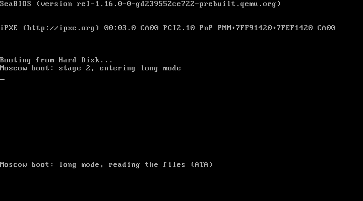
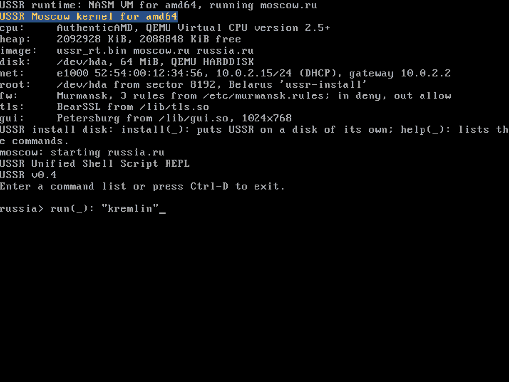

# Moscow



Moscow is the USSR kernel for amd64 PCs. A NASM boot loader starts a
NASM USSR runtime on bare metal, the runtime runs the kernel `moscow.ru`
(compiled from `moscow.su`), and the kernel mounts its root file system,
[Belarus](../belarus/README.md), and runs the shell `russia.ru`:
`src/russia/russia.su`, the USSR interpreter written in USSR, whose REPL
is the shell. The install disk holds it all:

| Part | Source | On the disk |
|------|--------|-------------|
| 1. boot loader | `arch/amd64/boot.nasm` | sectors 0..15 |
| 2. USSR runtime | `arch/amd64/ussr_rt.nasm` | `ussr_rt.bin`, in the boot image |
| 3. kernel | `moscow.su` | `moscow.ru`, in the boot image |
| 3. shell | `../russia/russia.su` | `russia.ru`, in the boot image |
| 4. root file system | `../belarus/belarus.su` | partition 1, from 4 MiB: `/bin`, `/boot`, `/etc`, `/src/ussr` |
| 5. installer | `install.su` | `/bin/install.ru` |

The boot image (parts 1 to 3, `moscow.img` on its own) sits in front of
the partition, where the boot loader reads it; the Belarus partition
holds the programs (`install.ru`, `stalin.ru`, `belarus.ru`), copies of
the boot files, `/etc` and the whole USSR project.

## Build and run

Needs NASM, QEMU and a built `ussr` (it compiles the `.su` files and
makes the disk with Stalin and Belarus):

    sh src/moscow/build.sh                  # -> build/moscow/ussr.img (and moscow.img)
    sh src/moscow/run.sh                    # window + serial on the terminal
    python src/moscow/tools/qemu_test.py    # headless test over serial, install included

`ussr.img` is a raw disk image; `dd` it to a USB stick to boot a real
PC with a BIOS (or CSM) whose disk answers on the legacy ATA ports (IDE,
or SATA in IDE mode); USB and AHCI drivers are not there yet. The
installer, though, writes only to virtual disks.

## Installing

Boot the install disk with a second, empty virtual disk and type
`install(_):` at the prompt:

    qemu-img create -f qcow2 hdd.qcow2 128M
    sh src/moscow/run.sh --hdb hdd.qcow2

```
russia> install(_):

=== USSR installer ===

Installing from /dev/hda (Belarus 'ussr-install')
Disks:
  /dev/hda  64 MiB  QEMU HARDDISK  (the install disk)
  /dev/hdb  128 MiB  QEMU HARDDISK
Install onto [/dev/hdb]:
...
Partitioning:
  1) the whole disk: a new MBR table, one Belarus partition, bootable (erases the disk)
  2) the whole disk: a new GPT table, one Belarus partition (erases the disk; Moscow boots from MBR disks only)
  3) keep the partitions there and add a Belarus one in the free space
  q) quit, changing nothing
Choose [1]:
Size of the Belarus partition in MiB, or max [max]:
File system label [ussr]:
Host name [moscow]: kremlin
What to copy [1]:
Type yes to go ahead [no]: yes
...
Belarus file system 'ussr' made in partition 1; copying:
  /
  /bin/
  /boot/
  /etc/
  /src/
808 files and directories copied; checking:
127 directories, 686 files, 7808255 bytes; 813 inodes, 8 block map nodes, map depth up to 2

Done: /dev/hdb boots USSR Moscow now. Halt, take the install disk out and boot from it.
```

The installer, `install.su`, is a USSR script: Stalin (`stalin_main`)
makes the partition table, Belarus the file system; the files go across
extent by extent with `bcopy`, then the boot image and the MBR's boot
code. It writes to QEMU disks only (their model says so) and never to
the install disk. Under `ussr` it installs into a disk image file the
same way, and refuses raw disks:

    ussr src/moscow/install.su --source build/moscow/ussr.img --target disk.img

## A session

    USSR Unified Shell Script REPL
    USSR v0.4
    Enter a command list or press Ctrl-D to exit.

    russia> foo(r): x [ set(r): {x * x} ]
    russia> foo(z): 7
    russia> print(_): z
    49
    russia> struct(P): "x:number" "y:string"
    russia> new(p): "P" 3 "q"
    russia> print(_): p
    P{x=3,y=`q`}
    russia> uptime(_):
    up 12 s
    russia> ls(_):
    -        112  .ussr_history
    d         57  bin
    d         54  boot
    d         31  etc
    d         14  src
    russia> run(st): "stalin" "show" "/dev/hda"
    Disk /dev/hda: 64 MiB, 131072 sectors of 512 bytes
    Table: MBR, disk signature 0x3CB66ED4
    #   START     END  SECTORS    SIZE  TYPE     FS       LABEL
    1*   8192  131071   122880  60 MiB  belarus  belarus  ussr-install
    Free: 1..8191 (4 MiB)
    russia> help(_):

Everything typed is USSR, run by russia.su's tree walker. The commands
russia.su does not know itself go to its host the way they go to ussr
when it runs on Windows or Linux (`ex_ext_b`: an `eval` of a one-line
call); on Moscow the host is the runtime, so they are kernel commands.
The file commands are the kernel's (`moscow.su` takes them over with
`k_syscall`) and work on the root file system:

| Command | Prints and returns |
|---------|--------------------|
| `ls(v): [path]`, `tree(_): [path]` | a directory, everything under a path |
| `cat(s): path`, `readfile(s): path` | a file's text |
| `writefile(r): path text` | writes a file (and its directories) |
| `make_dir`, `remove_file`, `file_exists`, `is_dir`, `list_dir` | as in ussr |
| `run(status): name [args ...]` | a program with the arguments: `/bin/name.ru`, `/bin/name.su` or the project's `/src/ussr/src/name/name.su`, or a path; a `.su` runs from its source through russia.ru; else a program of the boot image; 127 when missing |
| `open_file(h): path [mode]`, `read_line(s): h`, `read_file(s): h [n]`, `write_file(n): h text`, `close_file(r): h` | files by handle, as in ussr: `r`/`rb` read (-1 for no such file), `w` writes anew, `a` appends; what is written reaches the disk at `close_file` |
| `install(status):` | the installer, `/bin/install.ru` |
| `df(_):`, `fsck(n):` | the root file system and its free space; a check |
| `net(v):`, `ping(n): host [count]` | the network card and address; ICMP echo |
| `socket_tcp`, `socket_bind`, `socket_listen`, `socket_accept`, `socket_recv`, `socket_send`, `socket_close`, `socket_connect`, `wait_readable`, `wait_writable` | TCP as in ussr, over the kernel's own stack |
| `rename_path(r): from to`, `localtime(v): [seconds]` | as in ussr (UTC) |
| `bread`, `bwrite`, `bsize` on a path outside `/dev` | inside a file of the root file system, as ussr does on a host file: Dubna KV keeps its pages so |
| `uptime(s):` | seconds since boot |
| `mem(v):` | `[heap bytes, free bytes]` |
| `cpu(s):` | CPUID vendor and brand |
| `uname(s):`, `pwd(s):` | `USSR Moscow amd64`, `/` |
| `clear(_):`, `color(_): fg bg` | the screen, VGA colours 0..15 |
| `sleep(_): ms` | waits |
| `getenv`, `setenv`, `unsetenv` | the environment (`PS1` is the prompt, `HOSTNAME` comes from `/etc/hostname`) |
| `reboot(_):`, `halt(_):` | reset; stop |
| `help(_):` | this list |

Ctrl-D on an empty line ends the shell, and Moscow halts the machine
(QEMU exits when started with `isa-debug-exit`).

The console is a terminal: the shell reads its lines in raw mode, so
Up and Down go through the history, which it keeps in
`$HOME/.ussr_history` (`HOME` is `/`), and full-screen programs draw
with ANSI escapes on the VGA screen as on a serial terminal.

## Editing a file: Mbl

The Mbl editor (`src/Mbl/Mbl.su`, a vi-like editor) runs unchanged,
from its source:

    russia> run(_): "Mbl" "/home/notes.txt"

`i` inserts, Esc goes back, `:wq` writes and quits (the header of
`Mbl.su` lists the keys). The note is a file of the Belarus root: it
is there after `halt(_):` and the next boot:

    russia> cat(_): "/home/notes.txt"

The name finds `/src/ussr/src/Mbl/Mbl.su`, the project as the install
disk carries it; russia.ru compiles it, its `$include` of
`../libs/strings.su` included, and runs it. Any program of the
project runs that way, by name or by path. On the VGA screen a UTF-8
character takes one cell, as Mbl counts them; the VGA font has only
the ASCII ones, the others show as a block (a serial terminal shows
them all).

## The network: Novgorod from Moscow

Moscow has a TCP/IP stack of its own: the runtime drives the network
card (an Intel e1000, QEMU's usual one: `arch/amd64/net.inc`), and
`src/moscow/net.su`, USSR in the kernel, speaks Ethernet, ARP, IPv4,
ICMP, DHCP and TCP over it. At boot DHCP gives the address:

    net:     e1000 52:54:00:12:34:56, 10.0.2.15/24 (DHCP), gateway 10.0.2.2

The DHCP client (`src/moscow/dhcp.su`) keeps the lease: it asks the
server again at T1 (half the lease unless the server says otherwise),
asks any server at T2, and starts again from DISCOVER on a NAK or when
the lease runs out. `dhcp(_):` shows the lease, `dhcp(_): "renew"`
renews it now, and `dhcp(_): "release"` gives the address back:

    russia> dhcp(_):
    10.0.2.15 from 10.0.2.2, lease 86400s, renews in 43187s, ends in 86387s

The socket commands are the hosted ussr's, so the ROUND programs run
unchanged. Novgorod, the forum, from its source, on a port QEMU
forwards from this machine:

    sh src/moscow/run.sh --web 8080
    russia> run(_): "novgorod" "--http" "--host" "0.0.0.0" "--port" "8080" "--data" "/home/novgorod" "--static" "/src/ussr/src/novgorod/static" "--kvdb" "/home/novgorod/posts.kv"

and then http://127.0.0.1:8080/ in a browser on this machine. Its
posts go into a Dubna KV store, `/home/novgorod/posts.kv` (without
`--kvdb`, into files under `/home/novgorod/posts`): they are there
after the next boot.

How it works: nothing runs by itself, the card is polled. Every socket
command first reads what has come and answers it (ARP, ping, TCP),
retransmits what is overdue and then does its own work; a server
waiting for a client is the stack's clock. TCP keeps to what a server on
a quiet network needs: both handshakes, in-order data (a segment out of
order is dropped and acknowledged again), the peer's window, go-back-N
retransmission with a doubling timeout, FIN both ways and RST. What
comes in and what waits to be acknowledged are byte vectors, so any
bytes travel; `socket_recv` gives them as text (a USSR string holds no
byte 0), `socket_recv_bytes` as they are. There is one address;
`socket_bind` listens on it whatever host is given, and
`socket_connect` takes addresses (no DNS yet). Ukraine serves each
client in a task of its own: `wait_readable` on a listening socket
comes back after a moment even without a client, and russia.su lets its
other tasks run there, as ussr's scheduler does. Murmansk
([src/murmansk](../murmansk/README.md)) is the firewall: what comes in
needs a rule (the install disk opens ping, 8080 and 8443).

## Secure sockets: BearSSL

The `tls_*` commands Ryazan is written on are the kernel's too
(`src/moscow/tls.su`), so Ryazan, Ukraine's `uk_server_tls` and
Novgorod's HTTPS run unchanged. The cryptography is
[BearSSL](https://bearssl.org)'s: `build.sh` fetches BearSSL 0.6 (its
SHA-256 checked), compiles it freestanding with the glue
`src/moscow/lib/tls.c` into `/lib/tls.so`, and the kernel loads it at
boot through its ELF loader (`c_load`'s, `arch/amd64/cffi.inc`):

    tls:     BearSSL from /lib/tls.so

BearSSL only computes; the kernel moves the bytes. The engine's records
go out on the TCP connection, what comes in goes into the engine, and
the program's data goes in and out on the other side, each call of
`tls_handshake`, `tls_recv`, `tls_send` pumping both ways.

    russia> run(_): "novgorod" "--host" "0.0.0.0" "--port" "8443" "--data" "/home/novgorod" "--static" "/src/ussr/src/novgorod/static" "--kvdb" "/home/novgorod/posts.kv" "--cert" "/src/ussr/tests/ryazan/localhost.cert.pem" "--secret" "/src/ussr/tests/ryazan/localhost.key.pem"

serves https://127.0.0.1:8443/ (`run.sh --web 8443`). A server takes a
PEM certificate chain and its PEM private key (PKCS#12, Schannel's
`.p12`, is not read here); a client checks the server's chain and name
against the PEM certificates of `RYAZAN_CA_FILE`, else
`/etc/ssl/certs.pem`, at the date of the machine's clock. TLS 1.0 to
1.2 (BearSSL has no 1.3), ECDHE and RSA key exchange, AES-GCM,
ChaCha20-Poly1305 and AES-CBC. `tls_request` (the blocking HTTP
client) is not in Moscow; `ryazan_connect`, `ryazan_write` and
`ryazan_read` are.

## Windows: Kremlin, Mbltishi, Tver



Petersburg, USSR's GUI toolkit, is the kernel's too, so Petersburg
programs run from their source as they run on Windows and Linux:

    russia> run(_): "kremlin"

starts the desktop at 1024x768. Its TERMINAL pin opens Mbltishi
([src/Mbltishi](../Mbltishi/README.md)), a terminal window with the
USSR shell in it; FILES opens Tver over the Belarus root.

Petersburg's C code (`src/petersburg.c`, the hosted ussr's own) is
compiled for Moscow into `/lib/gui.so` (`src/moscow/lib/gui.c`) with
what it takes from a hosted system there:

- `lib/gui/libc.c`: the heap (an arena of 128 MiB the kernel gives it),
  formatted text, the files the kernel hands over for `fopen` (fonts,
  images), stderr on the serial port;
- `lib/gui/gl.c`: OpenGL 1.1 in software, the part Petersburg draws
  with (quads, lines, alpha textures for TrueType glyphs, glDrawPixels,
  scissor);
- `lib/gui/glfw.c`: GLFW on the machine: the Bochs/QEMU standard VGA's
  linear framebuffer at 32 bits (its picture starts 256 KiB into video
  memory, so text mode comes back intact), the PS/2 keyboard as GLFW
  key codes and the PS/2 mouse (a wheel one when it answers as one),
  windows composed bottom to top with title bars in Pobeda, dragged by
  them and closed by their box;
- `lib/gui/term.c`: Mbltishi's terminal, a grid of Pobeda glyphs that
  carries out the console's ANSI sequences;
- `lib/gui/moscow.c`: what `gui.su` calls.

`src/moscow/gui.su` makes every `petersburg_*` native a kernel command;
russia.su delivers the events itself (`petersburg_take_events`). The
screen goes graphic with the first window and back to text with the
last. A window belongs to the program that made it: a program started
from another (`launch`, which Kremlin calls, or `run`) puts its windows
over the other's, gets only its own events, and its windows go when it
ends. Moscow runs one program at a time, so Kremlin waits while what it
started runs; the screen stays alive meanwhile.

`terminal_run(st): t [program args...]` gives the console to terminal
`t` while the program runs: `k_console`, a runtime command, hooks a C
function to what is printed, one to what is read and one to
`terminal_size`. The PS/2 controller and the screen are the GUI's
while it is on (`moscow_gui`, which the runtime gives C libraries with
`moscow_ticks` and `moscow_term_raw`); the serial line stays the
console's.

`/etc/gui.conf` sets the screen (`screen=1024x768`, `1536x1024` or
`1920x1080`; `gui(_): "1920x1080"` for the next start) and whether the
desktop starts at boot (`desktop=on`). The installer writes
`desktop=on` on a full install: an installed system boots into Kremlin,
and a key in the first 3 seconds (the keyboard or the serial line)
gives the shell instead. The install disk boots to the shell, on VGA
and COM1, as before.

## Boot

- **Stage 1** (the MBR, 512 bytes) reads stage 2 with the BIOS extended
  disk read and jumps to it.
- **Stage 2** uses the BIOS only for what only it knows: A20 and the
  e820 memory map. It builds identity page tables for the first 4 GiB
  (2 MiB pages) and goes from real mode straight to long mode. From
  there on everything is 64-bit: an ATA PIO driver (primary master,
  LBA28) reads the file table (`MOSCOWFS`, sector 16) and every file it
  lists to memory from 1 MiB up, with no 640 KiB window, and stage 2
  jumps to the runtime (always the first file) with the boot information
  block in `rdi`.
- `arch/amd64/layout.inc` holds the sector and memory layout;
  `arch/amd64/image.nasm` assembles the disk with `incbin`.

Progress messages go to the screen and COM1, so a headless boot shows
where it stopped.

## The kernel

At boot `moscow.su` lists the disks (`bdevices`), mounts the first
Belarus file system it finds as the root, sets `HOSTNAME` from
`/etc/hostname`, prints `/etc/motd` and registers its commands. A kernel
command is a USSR function of `moscow.ru` taking its arguments as one
vector; the runtime calls it whenever a program loaded later (the shell,
a program of `/bin`) or an `eval` uses that name. It runs in the calling
program's memory and keeps nothing between calls but the root's device
and first sector: it mounts the file system each time, and writes
changes back before it returns. `run` reads the program from the file
system and hands it to `k_exec_bytes`. Without a Belarus disk (booting
`moscow.img` alone) the kernel still runs the shell, with no root.

## The runtime

`ussr_rt.nasm` is the USSR VM in assembly. It loads its own GDT and IDT
(CPU exceptions print and stop), sets up the console (VGA text mode and
COM1 at 115200, the PS/2 keyboard), the PIT at 100 Hz and the heap, then
loads `moscow.ru` and runs it.

Memory (`arch/amd64/mm.inc`): RAM is the largest usable region of the
BIOS map above the loaded files. When it goes past the boot loader's
4 GiB identity map, the runtime maps the rest (2 MiB pages, up to
64 GiB). The kernel's own heap takes half of it, up to 384 MiB; the rest
is 4 KiB page frames. Every address space shares the identity map (PML4
slot 0: the runtime, the kernel's heap, the devices) and has a private
512 GiB of its own (slot 1), mapped a page at a time on first touch: the
page fault handler gives an address of the running task's heaps a zeroed
frame and stops the machine for anything else. Heaps are TLSF, Two-Level
Segregated Fit: free blocks in lists by size class, a bitmap per level,
so an allocation, a split or a merge is a few steps whatever the heap
holds. Every program run gets a heap of its own, a 16 GiB window of the
private half, and gives every page of it back when it ends; `mem(_):`
counts the free frames and the kernel heap's free bytes. russia.ru
needs a few hundred MiB for a long session; the scripts give QEMU
2 GiB.

## Tasks

    russia> spawn(t): "novgorod" "--http" "--port" "8080" ...
    [1] novgorod
    russia> tasks(_):
       ID  STATE       CPU ms     KiB  NAME
        0  run           4120   35136  moscow
        1  wait          2350   61884  novgorod
    russia> kill(r): t

`spawn(id): program [args ...]` runs a program as a task of its own,
next to the shell; `tasks(_):` lists them, `kill(r): id` ends one
(status 137) and `wait(status): id` waits for one to end and gives its
status (`arch/amd64/task.inc`).

A task has its own stack, its own address space (page tables with its
private half: its heaps are out of the others' reach), its own copy of
the kernel's variables, made from the kernel as it booted, and its own
runtime state (struct types, C libraries, the kernel command areas).
Task 0 is the one the machine booted with: the kernel and the shell.
The PIT ticks at 100 Hz; when a task has had its 10 ms, the VM gives
the CPU away at its next instruction, unless the task is inside a kernel
command, which runs to its end or to where it waits. Waits are the
scheduler's, as russia's scheduler and ussr's kqueue-like event queue
(`src/eventq.c`) keep them: a task that sleeps, waits for a key or for
another task leaves the run queue with what it waits for - a time,
console input, a task's end - and the scheduler checks them each time it
picks the next task, round robin. With nothing to run the CPU halts
until the next interrupt.

The console is task 0's; another task reads the end of its input.
Hardware that keeps state is one task's at a time: the network's
commands (sockets, TLS) belong to the first task that uses them until
the program that did ends, and `ping`, `net` and `dhcp` are refused to
the others meanwhile; the same for the screen (Petersburg). So Novgorod
serves from a task while the shell goes on.

It reads `.ru` files as `ussr -c` writes them (format 3, VM ABI 3,
checked with the CRC) and runs them as `docs/USSR_VM_SPEC.md` describes:
32 registers, frames with their own locals, `init(ret): arg_cnt arg_vec`
as the entry point, `name!`/`name?` hash entries. Names are interned at
load time, so variables and builtins are found by index; the call-site
table gives builtins their return name (`struct(Name):`). Values are
null, 64-bit integers, reals (SSE2, printed like `%g`), strings,
booleans, vectors, structs and btrees (`btree.inc`, the same B+ tree
map as ussr's `src/btree.c`; it deletes lazily: a program's memory goes
back when it ends). `EVAL` runs what russia.su hands its host (lines
of builtin calls with variable, string, number or literal arguments);
`TEMPLATE` prints; `DECODE_UNO` loads `'...'` literals; `try` runs a
function in a VM of its own and reports whether it failed. Not
supported: `EXTERNAL`, `SCAN`, `GET`, `CHAIN`, `FILE`, `CD` (a program
using one stops with a message). `time` reads the RTC.

Disks (`ata.inc`): an ATA PIO driver (LBA28, polled, the cache flushed
after writes) finds the four IDE positions at boot and serves ussr's
block commands on them: `bread`, `bwrite`, `bsize`, `bcopy` and
`bdevices`, with the disks named `/dev/hda` .. `/dev/hdd`. Offsets are
bytes underneath (lba times any sector size), so Belarus and Stalin run
unchanged; a write that covers a disk sector in part reads it first.
`sha256.inc` gives Stalin the hash it makes GUIDs and disk signatures
with.

Builtins with the hosted ussr's meaning: `len byte slice chr vec push
pop at typeof struct new getf setf encode decode try write_stderr fail
text_bytes bytes_text crc32 sha256 clear_bytes btree btput btget bthas
btdel btlen btfirst btlast btfloor btceil btprev btnext btrange btkeys
bread bwrite bsize bcopy bdevices getenv setenv unsetenv getcwd terminal_getch
terminal_raw terminal_sane terminal_key_ready terminal_size terminal_escape
sleep file_exists readfile` (`gc`, `alias`, `keybind` answer null).
Library code such as `src/libs/strings.su` is compiled into the `.ru`.

The terminal: `terminal_raw(r):` (0) switches the console to raw mode,
where `terminal_getch` returns each byte as it comes, unechoed, and
`terminal_key_ready` says whether one is waiting; `terminal_sane(r):`
switches back, and then `terminal_getch` hands out a line at a time,
read with echo and Backspace as a cooked terminal does. In raw mode the
keyboard's arrows, Home, End, Insert, Delete, Page Up and Page Down
send the ANSI sequences a terminal sends (`ESC [ A` ...); Ctrl with a
letter gives its control code in either mode; serial input is raw
bytes already. Output goes to COM1 as it is and to the VGA screen
through an ANSI interpreter: `ESC [ row ; col H`, cursor moves (`A B C
D G d`), erasing (`J`, `K`) and SGR (`m`: reverse, bold, the 16
colours) are carried out, the other sequences dropped; a line wraps at
the character after the last column, as on a terminal.
`terminal_size(s):` is `"25 80"` and `terminal_escape(s):` the ESC
character, as ussr gives them.

The kernel's own services, used by `moscow.su`:

| Command | Does |
|---------|------|
| `k_getline(line):` | a console line (keyboard or serial), echoed, Backspace erases |
| `k_prompt(_): text` | text without a line end |
| `k_clear(_):` | clears the screen |
| `k_color(_): fg bg` | VGA colours 0..15 |
| `k_ticks(n):` | timer ticks since boot, 100 a second |
| `k_mem(v):` | `[total free]` heap bytes |
| `k_cpu(s):` | CPUID vendor and brand |
| `k_modules(v):` | file names in the boot image |
| `k_exec(status): name [args ...]` | runs a `.ru` of the image to its end; 127 when missing |
| `k_exec_bytes(status): bytes [args ...]` | runs the `.ru` in a byte vector (args: strings, or one vector of them) |
| `k_syscall(_): name function` | the kernel's `function` answers `name` from now on |
| `net_info(v):` | `[mac, link up]` of the network card, or null |
| `net_recv(v):` | the next Ethernet frame as a byte vector, or null |
| `net_send(n): head [tail [from [count]]]` | one frame: a byte vector, then a string or byte vector (or part of one) |
| `net_sum(n): data [from [count]]` | the 16-bit one's complement sum of IP checksums, folded |
| `k_elf_load(lib): bytes` | loads a freestanding x86-64 ELF shared object (`c_load` reads the file); `c_sym`, `c_call`, `c_alloc`, `c_free`, `c_read`, `c_write`, `c_string` as in ussr (`arch/amd64/cffi.inc`) |
| `k_reboot(_):`, `k_halt(_):` | reset; stop |

The heap is a bump heap with marks: `k_exec` (and `run`) release
everything the program allocated, and the struct types it declared,
when it ends. There is no collector inside one program yet.

## Tools

- `tools/rudump.py program.ru` lists a `.ru` file's instructions;
  `--summary` lists the opcodes and commands it uses, which is what the
  runtime has to provide.
- `tools/qemu_test.py` boots the install disk with COM1 on a TCP
  socket, types USSR into the russia.su REPL and checks each answer (as
  the hosted ussr gives them, plus the kernel's file commands, Stalin
  from `/bin` and the btree container), changes the prompt with
  `setenv`, and checks that Ctrl-D halts QEMU. Then it boots again with
  an empty qcow2 disk, runs `install(_):` and answers its questions, and
  boots the installed disk alone to check it (`--no-install` skips
  that).
